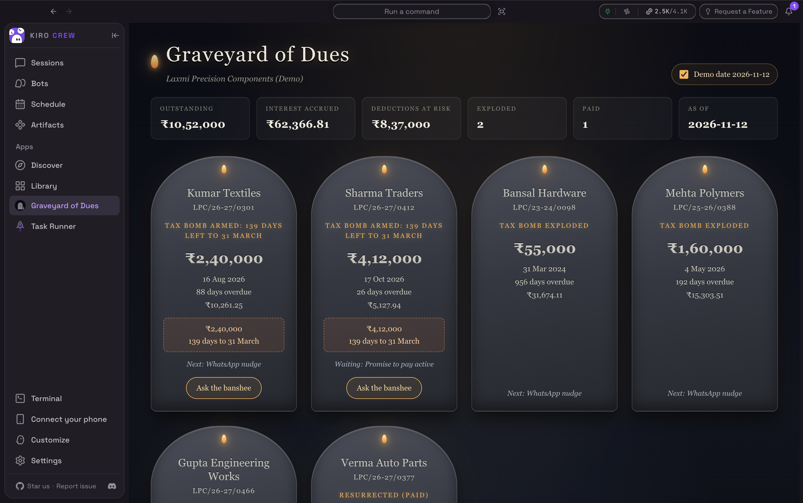

# Dues Banshee

A [Kiro Crew](https://kiro.dev) app for a micro or small supplier on Udyam who is owed money by buyers. It reads the deployed [Dues Banshee web app](https://dues-banshee.vercel.app) and shows what the dead invoices are doing.



## What it does

- **Graveyard of Dues page.** Each overdue invoice is a tombstone. The page shows the totals and, per tombstone, the state, principal, due date, interest, tax-bomb days left, deduction at risk and next step. Buyer and invoice names are shown as plain text.
- **Daily ladder.** The `daily-ladder` cron runs at 9:00 IST (`0 9 * * *`, `Asia/Kolkata`). It makes one POST to the web app's ladder endpoint. The ladder only creates drafts. Nothing reaches a buyer unless the owner approves it in the web app. The script is plain Python, makes no model call and uses no credits.
- **Tax-bomb skill.** `skills/tax-bomb` explains Income-tax Act 1961 s.43B(h) (up to tax year 2025-26) and Income-tax Act 2025 s.37(2)(g) (from tax year 2026-27): a buyer's deduction for a late payment to a micro or small enterprise is allowed only in the year it is actually paid, so an invoice already past its MSMED Act s.15 time limit and still unpaid on 31 March loses that year's deduction. The "Ask the banshee" button on a tombstone opens a draft chat with the figures from that tombstone.

The app is a thin client. Every amount, date, state and legal value comes from the web app as text and is shown as given. The app does no money, date or legal maths and never contacts a buyer. It sends requests only to the web app's summary and ladder endpoints. The data and empty views show the API's disclaimer: "Reminders a supplier sends to its own buyers. Not legal advice."

## Install (from a local path)

Requires Kiro Crew 0.13.0 or newer.

1. Install the app from this folder, using its absolute path:

   ```
   kirocrew app install /abs/path
   ```

2. Trust the app in **Settings → Security → Third-party apps**.
3. Enable it:

   ```
   kirocrew app enable dues-banshee
   ```

4. Create the secrets file by hand (see below).

### Secrets file

The app reads its credentials from `secrets.json` in the app's data folder:

```
~/.kiro/crew/apps/dues-banshee/data/secrets.json
```

If `KIROCREW_HOME` is set, the path is `$KIROCREW_HOME/apps/dues-banshee/data/secrets.json`.

Create it by hand and fill in the values for your Dues Banshee deployment:

```json
{"base_url": "", "crew_read_secret": "", "ladder_run_secret": ""}
```

- `base_url` is the web app's address, starting with `https://`.
- `crew_read_secret` is the bearer for `GET /api/crew/summary`.
- `ladder_run_secret` is the bearer for `POST /api/ladder/run`.

This file is never committed (`.gitignore` lists it) and is listed in `credentialMasks` in `app.json`, so Kiro Crew masks it from sandboxed processes. The app never creates or changes it, and never logs or returns its values.

### Optional: `ladder.json`

A sandboxed cron script may not be able to read the masked `secrets.json`. After install, use **Run now** on `daily-ladder`. Create `ladder.json` only if the run logs `failed not_configured` while `secrets.json` is valid. Put it next to `secrets.json`:

```
~/.kiro/crew/apps/dues-banshee/data/ladder.json
```

```json
{"base_url": "", "ladder_run_secret": ""}
```

Fill in the same two values as in `secrets.json`. This file is not masked and holds no `crew_read_secret`. The ladder secret only lets the ladder create drafts, and every send still needs your approval in the web app. The cron reads `secrets.json` first and falls back to `ladder.json`. The page backend never reads `ladder.json`.

With a custom KIROCREW_HOME, the cron may still look under ~/.kiro/crew/apps/dues-banshee/data/; put ladder.json there if Run now still logs failed not_configured.

### If the ladder stops

The scheduler pauses a script cron after 5 consecutive failures. If the ladder stops running, open the Schedule page, check the last error on `daily-ladder`, fix the cause, and resume it.

## Update

```
kirocrew app update dues-banshee --source <dir>
```

Your `data/` folder, including `secrets.json`, is kept across updates.

## Install from git (optional)

`kirocrew app install` accepts a git URL. To install from the git repository instead of a local path:

```
kirocrew app install https://github.com/rohhitrz/dues-banshee-crew
```

The local-path install above is the tested route.

## Tests

No test makes a live network call.

```
python3 -m unittest discover -s backend
python3 -m unittest discover -s cron
python3 -m unittest discover -s tests
cd ui && npm ci --ignore-scripts && npx vitest --run && npm run build
```

`npm run build` writes `ui/dist/index.mjs` and fails if the file is missing. The built bundle is committed, because local installs do not build.

## Layout

| Path | What |
|------|------|
| `app.json` | Kiro Crew manifest |
| `backend/server.py` | Python stdlib backend: `/health` and `/api/summary` |
| `cron/daily_ladder.py` | `daily-ladder` cron script |
| `ui/` | Vite + React page, built to `ui/dist/index.mjs` |
| `skills/tax-bomb/SKILL.md` | The s.43B(h) skill |
| `scripts/make_icon.py` | Generates `assets/icon.png` |

## License

MIT. See `LICENSE`.
